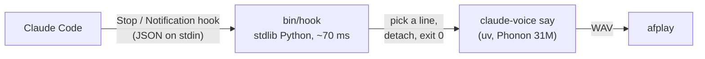

# claude-voice

Claude Code, out loud. When Claude finishes a turn, you hear a one-line summary in a voice you choose, generated on your Mac. When it stops to ask permission, it says so, and you don't have to keep watching the terminal.

Speech comes from [Phonon](https://huggingface.co/gradium/phonon-31m-en), a 31M-parameter text-to-speech model that runs on the CPU. Nothing is sent anywhere.

🔊 Hear it: [a finished turn](docs/samples/preston.m4a) · [a permission prompt](docs/samples/preston-permission.m4a) (catalog voice "Preston")

## Why

Long agent turns are a good time to look away. A spoken line tells you a turn has ended and whether it worked, so you can glance back only when you need to. It doesn't read the whole reply aloud. It aims for the sentence a teammate would say across the desk.

## How it works



- **On `Stop`:** the hook takes `last_assistant_message`. If the reply contains a `<spoken>…</spoken>` block, it says that block word for word. Otherwise it strips headings, tables, code blocks, links and markdown, and keeps whole sentences up to 35 words.
- **On `Notification`:** it says Claude Code's own message for permission prompts and MCP input requests, such as "Claude needs your permission to use Bash". It skips idle reminders.
- **Never blocks:** the hook hands the text to a detached `claude-voice say` process and exits at once. A new line cuts off the one still playing.
- **Speed:** Phonon loads in about 0.4 s and makes speech about 10–20× faster than real time on Apple Silicon. Run `claude-voice doctor` to measure it on your machine.

## Requirements

- macOS; audio plays through `afplay`. Tested on Apple Silicon.
- [uv](https://docs.astral.sh/uv/). The hook uses it to run the speaker in its own environment.
- Claude Code with plugin support

## Install

```shell
claude plugin marketplace add jasonm4130/claude-voice
claude plugin install claude-voice@claude-voice
```

The first spoken line downloads Phonon (about 65 MB) and builds the plugin's Python environment, so it arrives a few seconds late. After that, lines play in well under a second.

## Use

Voice is opt-in for each session, so headless runs, CI and agent teammates stay quiet:

```shell
CLAUDE_VOICE=1 claude
```

To make it your default for interactive use, put `export CLAUDE_VOICE=1` in your shell profile. Scripts that call `claude -p` should then unset it.

Check the setup and hear a test line without Claude:

```shell
git clone https://github.com/jasonm4130/claude-voice && cd claude-voice
uv run claude-voice doctor
uv run claude-voice say "Build passed, two warnings."
uv run claude-voice stop
```

`doctor` prints one line per check. Here it is on an M5 Max:

```
ok   macOS: darwin
ok   afplay on PATH
ok   uv on PATH
note CLAUDE_VOICE=1 in this shell: hooks stay silent without it
ok   voice: ~/.config/claude-voice/voice.safetensors
ok   Phonon: loaded in 0.43 s; 2.1 s of speech in 0.18 s
```

## Choosing a voice

The speaker uses the first of these that is set:

1. **A voice file.** By default `~/.config/claude-voice/voice.safetensors`; set `CLAUDE_VOICE_FILE` to use another path.
2. **A catalog voice.** `CLAUDE_VOICE_NAME=Preston`. Phonon ships 37 English voices (25 standard plus 12 characters); list them with `uvx ptts --lang en --list-voices`.
3. **Phonon's default voice.**

### Designing your own

Gradium Studio's Voice Design builds a voice from a text description. It is free on every plan, and only the description leaves your machine.

1. Sign in at [studio.gradium.ai](https://studio.gradium.ai/) and open **Voice Design**.
2. Describe the speaker. This prompt gives a calm developer voice:

   > Male, around 30, neutral international English accent with no strong regional markers. Smooth, clean voice with no gravel or roughness. Relaxed and articulate, medium pace, quietly confident, slightly dry humour. Sounds like a software developer explaining something to a colleague at the next desk: precise, casual, thoughtful. Not a tradesman, not a broadcaster, not a salesman. Close-mic, quiet room.

   Avoid the word "engineer": it tends to produce a hard-hat voice.
3. Generate a few takes. Judge them on a line full of numbers and file names, not on small talk.
4. Choose ⋮ → **Download for Phonon**, and save the file as `~/.config/claude-voice/voice.safetensors`.

You can also clone a voice from a 10-second recording in Studio, but only with the speaker's consent. The recording is uploaded to Gradium; making the voice is the only step that isn't local. Phonon's speaker encoder is not open, so voices can't be made offline.

## Getting better spoken lines

The summary without a `<spoken>` block works, but Claude can write a better one itself. Add this to your `CLAUDE.md`:

```markdown
## Spoken summary
End every reply with one `<spoken>` block, under 35 words, for text-to-speech:
the outcome, anything that needs me, and the next step. No code, paths or markdown.
Say numbers as words a person would say. Example:
<spoken>Tests pass. The migration's ready, but it drops the users index, so I need a yes before I run it.</spoken>
```

The block also shows in the terminal. That is the trade-off for a summary written by the model rather than cut down by a script.

## Configuration

| Variable | Default | Effect |
| --- | --- | --- |
| `CLAUDE_VOICE` | unset | `1` turns speech on for the session |
| `CLAUDE_VOICE_FILE` | `~/.config/claude-voice/voice.safetensors` | Voice file to use |
| `CLAUDE_VOICE_NAME` | unset | Catalog voice, used when no voice file is found |
| `CLAUDE_VOICE_MAX_WORDS` | `35` | Word limit for summaries cut down without a `<spoken>` block |
| `CLAUDE_VOICE_NOTIFY` | `1` | `0` silences permission and input prompts |

Each spoken line is appended to `~/.local/state/claude-voice/spoken.log`.

## Troubleshooting

- **Silence.** Run `uv run claude-voice doctor` first. Check that the session was started with `CLAUDE_VOICE=1` (`echo $CLAUDE_VOICE` in a `!` command), and look in `spoken.log` to see whether a line was produced.
- **The first line is late.** That is the one-time model download and environment build.
- **It reads `src` as "S R C".** Phonon spells out short tokens. Put a `<spoken>` block in the reply, written the way you'd say it.
- **Lines talk over each other.** They shouldn't: each new line stops the last. If several sessions all have `CLAUDE_VOICE=1`, they share one player, and the newest line wins.

## Privacy

Speech is generated locally. The hook reads only the hook payload Claude Code sends it: the final reply text, or the notification message. It writes only the log above and a temporary WAV file, which it deletes after playback. Nothing is sent over the network, apart from the one-time download of the model from Hugging Face.

## Research

[`docs/research/`](docs/research/) holds the survey behind this design, done in November 2026. It covers speech-to-text, text-to-speech, Claude Code integration points, language and framework choice, speech-to-speech and full-duplex models, turn-taking and echo cancellation, and voice UX for coding agents. It is a snapshot: most figures come from the cited sources, not from this project's own measurements.

## Roadmap

- Push-to-talk dictation with a local speech-to-text model, such as Qwen3-ASR 0.6B on MLX
- Spoken permission prompts that name the command and what it changes
- A full-duplex speech-to-speech front that hands work to Claude Code (see research report 8)

## Development

```shell
uv sync
uv run pytest
uv run ruff check . && uv run ruff format --check .
claude --plugin-dir .   # load this checkout as a plugin for one session
```

[AGENTS.md](AGENTS.md) has the rules for contributors and coding agents.

## Licence

MIT, see [LICENSE](LICENSE). Phonon 31M English and its voice catalog are Apache 2.0, from [Gradium](https://gradium.ai/phonon). This project is not affiliated with Gradium or Anthropic.
