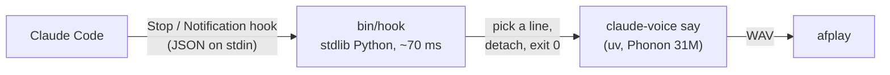

# claude-voice

Claude Code, out loud. When Claude finishes a turn, you hear a one-line summary in a voice you choose. When it stops to ask permission, it says so.

Speech comes from [Phonon](https://huggingface.co/gradium/phonon-31m-en), a 31M-parameter text-to-speech model that runs locally on the CPU.

🔊 Hear it: [a finished turn](docs/samples/preston.m4a) · [a permission prompt](docs/samples/preston-permission.m4a) (catalog voice "Preston")

## Why

Long turns are a good time to look away. A spoken line says the turn ended and whether it worked: the sentence a teammate would say across the desk, not a reading of the reply.

## How it works



- **On `Stop`:** a `<spoken>…</spoken>` block in the reply is said word for word. Otherwise the hook strips headings, tables, code, links and markdown, and keeps whole sentences up to 35 words.
- **On `Notification`:** it says Claude Code's own message for permission prompts and MCP input requests, such as "Claude needs your permission to use Bash". Idle reminders are skipped.
- **Never blocks:** the hook hands the text to a detached `claude-voice say` and exits at once. A new line cuts off the one still playing.
- **Speed:** Phonon loads in about 0.4 s and runs 10-20x faster than real time on Apple Silicon. `claude-voice doctor` measures it on your machine.

## Requirements

- macOS, with audio through `afplay`. Tested on Apple Silicon.
- [uv](https://docs.astral.sh/uv/), which runs the speaker in its own environment.
- Claude Code with plugin support
- For push to talk: Apple Silicon, and about 900 MB for the speech-to-text model

## Install

```shell
claude plugin marketplace add jasonm4130/claude-voice
claude plugin install claude-voice@claude-voice
```

The first line downloads Phonon (about 65 MB) and builds the plugin's environment, so it arrives a few seconds late. After that, lines play in well under a second.

## Use

Voice is opt-in per session, so headless runs and agent teammates stay quiet:

```shell
CLAUDE_VOICE=1 claude
```

To make it the default, put `export CLAUDE_VOICE=1` in your shell profile, and unset it in scripts that call `claude -p`.

Check the setup and hear a test line without Claude:

```shell
git clone https://github.com/jasonm4130/claude-voice && cd claude-voice
uv run claude-voice doctor
uv run claude-voice say "Build passed, two warnings."
uv run claude-voice stop
```

`doctor` prints one line per check, ending with the Phonon load time, for example `ok   Phonon: loaded in 0.43 s; 2.1 s of speech in 0.18 s`.

## Push to talk

Hold a key, speak, let go: your words are transcribed on your Mac and pasted where you're typing, usually the Claude Code prompt. Nothing is submitted; you read it and press Enter. Pressing the key also cuts off any line being spoken, so it doubles as "be quiet".

```shell
cd claude-voice   # your clone
uv sync --extra listen
uv run --extra listen claude-voice listen
```

Leave it running in a spare terminal tab. The default key is right Option; holding it with another key (an Option chord) cancels the recording, so typing special characters still works. The first run downloads [Qwen3-ASR 0.6B](https://huggingface.co/mlx-community/Qwen3-ASR-0.6B-6bit) (6-bit MLX, about 860 MB) from Hugging Face. After that, a short clip is transcribed in about 0.15 s on an M5 Max.

- **Permissions.** macOS asks for these for the terminal app that runs `listen`, not for Python: **Microphone**, plus **Accessibility** and **Input Monitoring** (to see the hotkey and send Cmd-V). Grant them in System Settings → Privacy & Security, then restart the terminal. Without Microphone access, macOS may hand over silence instead of an error; `listen` prints a hint when a clip is all zeros.
- **How text gets in.** The text goes on the clipboard, `listen` sends Cmd-V, and your previous clipboard comes back a moment later. Pasting is a single event, so characters can't be dropped or reordered, and the terminal sees it as a paste rather than a stream of keystrokes. Newlines are flattened to spaces so a paste can't submit anything.
- **Silence.** Leading and trailing silence is trimmed, and a clip with no speech is dropped rather than transcribed; the model tends to invent a word or two from room noise.
- **Identifiers.** It hears `load_model` and `speak.py` when you say "load model" and "speak dot py", but check anything exact before you submit.
- **Check it without the mic:** `uv run --extra listen claude-voice listen --file clip.wav` prints the transcript.

## Choosing a voice

The first of these that is set wins:

1. **A voice file.** `~/.config/claude-voice/voice.safetensors`, or the path in `CLAUDE_VOICE_FILE`.
2. **A catalog voice.** `CLAUDE_VOICE_NAME=Preston`. Phonon ships 37 English voices; list them with `uvx ptts --lang en --list-voices`.
3. **Phonon's default voice.**

### Designing your own

Gradium Studio's Voice Design builds a voice from a text description. Only the description leaves your machine.

1. Open **Voice Design** at [studio.gradium.ai](https://studio.gradium.ai/).
2. Describe the speaker. This gives a calm developer voice:

   > Male, around 30, neutral international English accent with no strong regional markers. Smooth, clean voice with no gravel or roughness. Relaxed and articulate, medium pace, quietly confident, slightly dry humour. Sounds like a software developer explaining something to a colleague at the next desk: precise, casual, thoughtful. Not a tradesman, not a broadcaster, not a salesman. Close-mic, quiet room.

   Avoid the word "engineer"; it produces a hard-hat voice.
3. Generate a few takes and judge them on a line full of numbers and file names.
4. Choose ⋮ → **Download for Phonon** and save it as `~/.config/claude-voice/voice.safetensors`.

You can also clone a voice from a 10-second recording in Studio, with the speaker's consent. The recording is uploaded to Gradium. Phonon's speaker encoder is not open, so voices can't be made offline.

## Getting better spoken lines

Claude writes a better summary than the script can cut. Add this to your `CLAUDE.md`:

```markdown
## Spoken summary
End every reply with one `<spoken>` block, under 35 words, for text-to-speech:
the outcome, anything that needs me, and the next step. No code, paths or markdown.
Say numbers as words a person would say. Example:
<spoken>Tests pass. The migration's ready, but it drops the users index, so I need a yes before I run it.</spoken>
```

The block also shows in the terminal.

## Configuration

| Variable | Default | Effect |
| --- | --- | --- |
| `CLAUDE_VOICE` | unset | `1` turns speech on for the session |
| `CLAUDE_VOICE_FILE` | `~/.config/claude-voice/voice.safetensors` | Voice file to use |
| `CLAUDE_VOICE_NAME` | unset | Catalog voice, used when no voice file exists |
| `CLAUDE_VOICE_MAX_WORDS` | `35` | Word limit when there is no `<spoken>` block |
| `CLAUDE_VOICE_NOTIFY` | `1` | `0` silences permission and input prompts |
| `CLAUDE_VOICE_HOTKEY` | `alt_r` (right Option) | Push-to-talk key: a [pynput key name](https://pynput.readthedocs.io/en/latest/keyboard.html#pynput.keyboard.Key) or one character, joined with `+` for a combination, such as `ctrl+f13`. `right_option`, `right_command` and `right_control` also work |
| `CLAUDE_VOICE_STT_MODEL` | `mlx-community/Qwen3-ASR-0.6B-6bit` | Speech-to-text model for `listen` |

Each spoken line is appended to `~/.local/state/claude-voice/spoken.log`.

## Troubleshooting

- **Silence.** Run `uv run claude-voice doctor`, check `CLAUDE_VOICE=1` was set when the session started, and look in `spoken.log`.
- **It reads `src` as "S R C".** Phonon spells out short tokens. Use a `<spoken>` block written the way you'd say it.
- **Overlapping lines.** Each new line stops the last. Sessions that all have `CLAUDE_VOICE=1` share one player, and the newest wins.

## Privacy

Speech is generated locally. The hook reads only the payload Claude Code sends it (the final reply or the notification message) and writes only the log above and a temporary WAV file, deleted after playback. The only network calls are the model downloads from Hugging Face. Push to talk records only while the key is held, transcribes in memory, and keeps neither audio nor text.

## Research

[`docs/research/`](docs/research/) is the November 2026 survey behind this design. It is a snapshot; most figures come from cited sources, not this project's measurements.

## Roadmap

- Spoken permission prompts that name the command and its effect

## Development

```shell
uv sync
uv run pytest
uv run ruff check . && uv run ruff format --check .
claude --plugin-dir .   # load this checkout as a plugin
```

Contributor rules are in [AGENTS.md](AGENTS.md).

## Licence

MIT, see [LICENSE](LICENSE). Phonon 31M English and its voice catalog are Apache 2.0, from [Gradium](https://gradium.ai/phonon). This project is not affiliated with Gradium or Anthropic.
